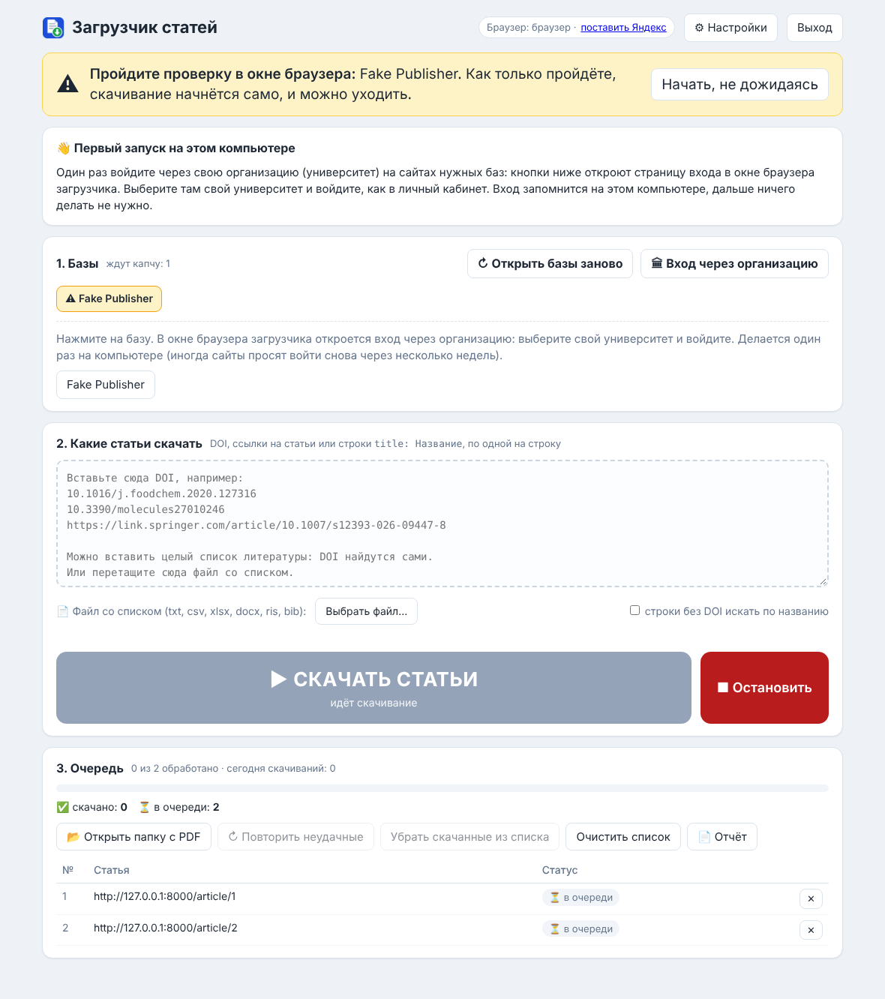

# article-downloader

Загрузчик научных статей (PDF) для Windows: по DOI, ссылке или названию, через
подписки университета («Войти через организацию»). Портативная версия: папка
распаковывается на любом компьютере с Windows и работает без установки.

**Как это работает:** двойной щелчок по «СКАЧАТЬ СТАТЬИ» → открывается браузер со всеми
базами → проходите капчу → дальше программа скачивает сама, можно уходить.



## Что где лежит

| Путь | Что это |
|---|---|
| [`HANDOFF.md`](HANDOFF.md) | **Начать отсюда.** Полное описание: задача, устройство, что проверено и что ещё нет. |
| [`КАК ПРОДОЛЖИТЬ.md`](КАК%20ПРОДОЛЖИТЬ.md) | Пошаговый протокол: как продолжить работу с Claude Code. |
| `portable/` | Исходники программы v6.0 (окно `app.py`, загрузчик `article_downloader.py`, интерфейс). |
| `tools/build_portable.py` | Собирает готовую папку и `ArticleDownloader_Portable.zip` (добавляет Python и библиотеки). |
| `tests/` | Тестовый стенд: поддельный сайт издательства с капчей, проверки разбора DOI. |
| `screenshots/` | Как выглядит окно программы. |
| `docs/ЗАДАНИЕ_v6.1_поиск_DOI.md` | Следующая задача: стартовое окно с двумя кнопками и поиск DOI в Scopus / Web of Science. |
| [`docs/КАК_ПОЛУЧИТЬ_КЛЮЧИ_API.md`](docs/КАК_ПОЛУЧИТЬ_КЛЮЧИ_API.md) | Пошаговая инструкция со ссылками: как получить ключи Scopus и Web of Science. |
| `original_v5.24/` | Предыдущая версия для сравнения; `changes_article_downloader.diff` — что изменено. |

## Собрать программу

Нужен Python 3.10+ и интернет (на Windows или Linux):

```
python tools/build_portable.py
```

Результат: `dist/ArticleDownloader/` и `dist/ArticleDownloader_Portable.zip` (около 54 МБ).
Готовую сборку в репозиторий не кладём: она собирается этой командой.

## Состояние

Версия 6.0 проверена на тестовом стенде (Linux, поддельное издательство).
**На Windows и на настоящих сайтах издательств ещё не запускалась**; что проверить,
перечислено в `HANDOFF.md`, раздел 4.
