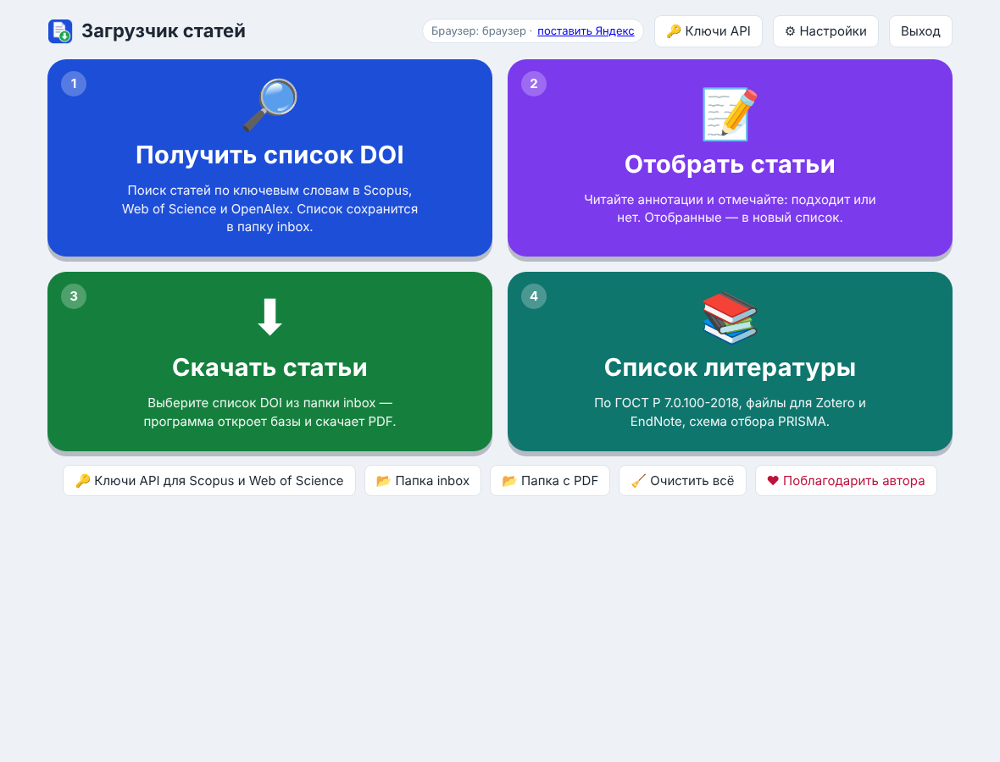

# Загрузчик статей

Бесплатная программа для Windows (и Mac — бета), которая помогает сделать обзор литературы: находит статьи
по ключевым словам, помогает отобрать нужные, сама скачивает PDF через подписку вашего
университета («Войти через организацию») и собирает список литературы по ГОСТ.
Работает без установки: архив распаковывается в папку на любом компьютере с Windows 10 или 11.

👉 **[Скачать ArticleDownloader_Portable.zip](https://github.com/solzeworot-commits/article-downloader/releases/download/portable-latest/ArticleDownloader_Portable.zip)**
(около 54 МБ). Как установить и как проверить, что архив настоящий, — на странице
[релиза](https://github.com/solzeworot-commits/article-downloader/releases/tag/portable-latest).

🍏 **Для Mac (бета): [Скачать ArticleDownloader_Mac.zip](https://github.com/solzeworot-commits/article-downloader/releases/download/portable-latest/ArticleDownloader_Mac.zip)** — как запустить, ниже в разделе «Для Mac».

## 🆕 Новое в версии 8.8

- **☁ Облако — качать на рабочем компьютере, сидя дома.** Доступ к платным базам есть только на работе (в вузе)?
  Оставьте программу открытой на рабочем компьютере и отправляйте ей списки DOI из дома — она скачает статьи через
  подписку университета, а PDF сами появятся у вас дома. Связь идёт через **ваше** облако (Яндекс Диск, Google Диск,
  OneDrive, Облако Mail.ru, Dropbox или iCloud) или любую общую папку: сама программа ничего не отправляет в интернет
  и сервер не нужен. Полоска «☁ Облако» на главной показывает цветом, что происходит на рабочем компьютере: жёлтый —
  качает, оранжевый — капча (нужен человек рядом с ним), зелёный — готово, красный — не отвечает. Капча не обходится,
  паузы и дневной лимит работают как обычно.

## Новое в версии 8.7

- **📄 Привести в порядок свой список** — в окне «📚 Список литературы»: загрузите Word со своим списком, оформленным
  как попало, и программа оформит его по ГОСТ или в нужном стиле. Источники с DOI берутся по DOI, без DOI — ищутся в
  Crossref по тексту ссылки (с проверкой названия, года и авторов, такие помечены для проверки), ненайденные остаются
  как были, а с ИИ-помощником их можно оформить. Нумерация — как в документе; результат — в Word, .docx или .txt.

## Новое в версии 8.6.1

- Исправлено: Защитник Windows принимал архив 8.6 за троян и не давал обновиться. Код для Mac больше не попадает
  в архив для Windows.

## Новое в версии 8.6

- **🍏 Версия для Mac (бета)** — та же программа для Mac с процессором Apple (M1 и новее) и Intel. Собирается и
  проверяется автоматически на Mac; скачивает статьи через Chrome, Edge или Яндекс.Браузер.

## 🍏 Для Mac (бета)

1. Скачайте **ArticleDownloader_Mac.zip** (около 130 МБ) и дважды щёлкните по нему — появится папка **ArticleDownloader**.
2. Дважды щёлкните **«СКАЧАТЬ СТАТЬИ.command»**. В первый раз Mac скажет, что не может проверить разработчика, — это
   нормально: программа бесплатная и не подписана в Apple (подпись стоит 99 $ в год). Откройте ** → Системные настройки →
   Конфиденциальность и безопасность**, прокрутите вниз и нажмите **«Всё равно открыть»**, затем введите пароль Mac.
   На macOS до 15 можно проще: правой кнопкой по файлу → **«Открыть»** → **«Открыть»**.
3. Откроется Терминал, через несколько секунд — окно программы. Дальше программа запускается двойным щелчком без вопросов.

Для скачивания статей нужен **Google Chrome, Microsoft Edge или Яндекс.Браузер** (Safari не подходит). Работает на Mac
с процессором Apple (M1 и новее) и Intel, macOS 11 и новее. Без вопросов системы можно поставить одной командой в Терминале:

```
cd ~/Downloads && curl -LO https://github.com/solzeworot-commits/article-downloader/releases/download/portable-latest/ArticleDownloader_Mac.zip && ditto -x -k ArticleDownloader_Mac.zip . && open ArticleDownloader
```

Это бета-версия: её собирают и проверяют автоматически на Mac, но живых отзывов пока мало. Если что-то не так —
кнопка **«🛟 Сообщить о проблеме»** в программе или чат в Telegram.

## Новое в версии 8.5

- **🔔 Новое по теме** — сохранённый поиск программа запоминает и через месяц напоминает на главной: «🔔 Проверить новое»
  ищет заново и сохраняет отдельным списком только статьи, которых не было в прошлых результатах. Все темы — в карточке
  «🔔 Мои темы» в окне поиска.

## Новое в версии 8.4

- **🔍 Поиск по тексту статей** — в окне «📚 Список литературы»: напишите, что ищете (например, «ultrasound 40 kHz»),
  и программа покажет, в каких скачанных PDF и на какой странице это написано; кнопка открывает PDF на этой странице.
  Без ИИ, бесплатно.
- **📝 План обзора** — ИИ-помощник предлагает разделы обзора, раскладывает по ним отобранные статьи и пишет, чего не
  хватает в литературе. Копируется в Word или сохраняется файлом .docx.

## Новое в версии 8.3

- **🔁 Найти ещё по ссылкам** — в отборе: программа смотрит, на какие работы ссылаются ваши статьи «✓ Подходит» и кто
  ссылается на них, и показывает самые связанные — то, что пропустил поиск по ключевым словам. Отмеченные попадают в отбор,
  в схеме PRISMA — отдельной строкой. Бесплатно, через OpenAlex.
- **⚠ Статья отозвана** — красная метка в отборе и в списке литературы, если журнал отказался от статьи (retracted).

## Новое в версии 8.2

- Нижние кнопки главной — яркие, в один ряд: **Списки DOI** (папка inbox), **Скачанные PDF**, **Поделиться программой**,
  Telegram, MAX и **Поблагодарить автора** с пиратским флагом.
- Ключи API открываются одной кнопкой — кружком «API» в центре главной (лишние кнопки убраны).
- В «О программе» — чьи товарные знаки DOI®, Scopus® и Web of Science™.

## Новое в версии 8.1

- **📖 ИНСТРУКЦИЯ** — жёлтая плашка на главной: коротко, с чего начать и зачем (ключи, слова, отбор, капча,
  список литературы и зачем схема PRISMA, ИИ-помощник).
- **🧹 Очистить всё** — заметной плашкой под ИИ-помощником.
- Окно программы само подстраивается под экран и запоминает размер, который вы ему дали.
- Галочка OpenAlex в поиске стоит сама, если ключ OpenAlex сохранён (снять можно вручную — программа запомнит).

## Новое в версии 8.0

- **📊 Таблица по статьям** в окне «📚 Список литературы»: ИИ-помощник читает скачанные PDF (или аннотации, если PDF
  нет) и заполняет столбцы — объект, метод, условия, главные результаты (столбцы можно поменять). Таблица видна в
  окне и сохраняется для Excel (.xlsx).

## Новое в версии 7.9

- **🌐 Перевод аннотаций** в окне «📝 Отобрать статьи»: кнопка под аннотацией (или галочка «переводить каждую
  статью сразу») — ИИ-помощник переводит название и аннотацию на русский; перевод запоминается.

## Новое в версии 7.8

- **📚 Список литературы в стиле журнала:** кроме ГОСТ — APA 7, Elsevier Harvard, Vancouver, ACS, IEEE, Chicago
  и Nature (встроены, работают без интернета), а ещё стиль любого из примерно 11 000 журналов: вводите название
  журнала — оформляет сервис doi.org по стилю из базы Citation Style Language (той же, что у Zotero и Mendeley).
- Копирование с курсивом и жирным (вставляется в Word как надо) и сохранение **для Word (.docx)**.

## Новое в версии 7.7

- **🤖 ИИ-помощник на выбор:** Perplexity, ChatGPT, Claude, GigaChat или YandexGPT (Алиса) — вкладки в окне
  помощника, у каждого сервиса пошаговая инструкция. Из России работают Perplexity, GigaChat и YandexGPT
  (два последних — с оплатой российской картой); ChatGPT и Claude в России не работают.

## Новое в версии 7.6

- **🤖 ИИ-помощник** (по желанию, на вашем ключе Perplexity): опишите тему своими словами — он подберёт
  английские слова и синонимы для поиска; при отборе читает аннотации и подсказывает, подходит ли статья.
  На главной — плашка: красная, пока помощник не подключён, зелёная — когда подключён; инструкция со
  скриншотами внутри программы;
- **💬 Чат программы** в [Telegram](https://t.me/ArticleDownloaderChat) и
  [MAX](https://max.ru/join/_ADhfiFX_Bf37RsP1VR8hDHUdFgj_im_R5DqDx4Iseo) — кнопки внизу главного окна:
  вопросы, советы, новости;
- синонимы можно писать в одной строке через «;» — программа сама соберёт запрос (одно из слов строки
  И одно из слов следующей строки);
- 7.6.1–7.6.2: помощник переведён на новый адрес API Perplexity, кнопки чатов с иконками.

Программы 7.2 и новее предложат обновиться сами: красный квадратик с номером версии рядом с названием.

## Как это работает

Двойной щелчок по «СКАЧАТЬ СТАТЬИ» → главное окно. Сначала красный кружок **«API»** в центре —
бесплатные ключи OpenAlex и Web of Science (один раз, по шагам с картинками), потом четыре шага:

1. **🔎 Получить список DOI** — поиск по ключевым словам в Scopus, Web of Science и OpenAlex
   (по ключам API или через экспорт с сайта), бесплатные подсказки слов; список сохраняется
   в папку `inbox`;
2. **📝 Отобрать статьи** — аннотации подтягиваются сами, вы отмечаете «подходит / нет»
   кнопками или клавишами 1/2/3;
3. **⬇ Скачать статьи** — выбираете список из `inbox` → программа открывает базы в браузере →
   проходите капчу → дальше она скачивает сама, можно уходить. Пауза между статьями и
   дневной лимит берегут подписку университета;
4. **📚 Список литературы** — по ГОСТ Р 7.0.100-2018, APA, Vancouver, ACS, IEEE и другим стилям
   или в стиле любого журнала; для Word (.docx), файлы для Zotero / EndNote (.ris) и LaTeX (.bib),
   таблица по статьям для Excel (с ИИ-помощником), схема отбора PRISMA с цифрами.



Под четырьмя шагами — плашка **🤖 ИИ-помощник** (по желанию, на вашем ключе Perplexity): красная,
пока не подключён, зелёная — когда подключён. Он подбирает слова для поиска по теме, описанной
своими словами, и при отборе читает аннотации и советует «подходит / под вопросом / не подходит»
с причиной. Решаете всё равно вы.

## Ещё в программе

- **🆕 Обновления** — рядом с названием синий квадратик с номером версии; если вышла новая,
  загорается красный квадратик с её номером, а кнопка «Обновить автоматически» сама скачает
  и поставит новую версию;
- **🛟 Сообщить о проблеме** — ответы на частые вопросы, а если не помогло — отчёт автору
  (ключи, пароли и имя пользователя Windows в него не попадают);
- **🔑 Ключи API** — пошаговые инструкции со ссылками, как получить ключи Scopus и Web of Science;
- **ℹ О программе** — версия, автор, условия лицензии;
- **📤 Поделиться программой** — QR-код, ссылка и готовое сообщение для Telegram, WhatsApp,
  ВКонтакте и почты;
- **🌐 EN / RU** — окно на русском или английском;
- **💬 Чат программы** — вопросы, советы и новости:
  [Telegram](https://t.me/ArticleDownloaderChat) и [MAX](https://max.ru/join/_ADhfiFX_Bf37RsP1VR8hDHUdFgj_im_R5DqDx4Iseo).

### 🤖 ИИ-помощник (с версии 7.6)

Необязательный. Работает на **вашем собственном** ключе одного из сервисов: Perplexity, ChatGPT (OpenAI),
Claude (Anthropic), GigaChat (Сбер) или YandexGPT (Яндекс) — с версии 7.7 на выбор. Вы регистрируетесь в
сервисе, пополняете счёт API и вставляете ключ в программу — инструкции со скриншотами в самой программе.
Из России работают Perplexity (зарубежная карта или Apple Pay), GigaChat и YandexGPT (российская карта);
OpenAI и Anthropic пользователей в России не обслуживают. Деньги за запросы списывает сервис с вашего счёта:
подбор слов — меньше цента, предотбор сотни статей — несколько центов; программа показывает, сколько
потрачено. В Perplexity уходит только тема и названия с аннотациями статей; ключ хранится только на
вашем компьютере.

## Планы

Уже сделано: ИИ-помощник — подбор слов по теме и предотбор статей (7.6), выбор из пяти сервисов (7.7),
стили журналов (7.8), перевод аннотаций (7.9), таблица по скачанным статьям для Excel (8.0). Дальше:
- 🌐 свой сервер ИИ-помощника — работать без своего ключа и зарубежной карты, оплата в рублях прямо в программе.

Сколько раз программу скачали и запускали —
[📊 статистика](https://github.com/solzeworot-commits/article-downloader/releases/tag/download-stats)
(обновляется сама каждый час).

Поддержать развитие проекта можно кнопкой **«❤ Поблагодарить автора»** в программе
(СБП или криптовалюта). Нашли ошибку — кнопка **«🛟 Сообщить о проблеме»**,
[чат в Telegram](https://t.me/ArticleDownloaderChat) или
[Issues](https://github.com/solzeworot-commits/article-downloader/issues).

## In English

A free Windows program for literature reviews: it finds articles by keywords in Scopus,
Web of Science and OpenAlex, helps you screen them by abstracts, downloads the PDFs
through your university's subscription («Sign in via your organization») and builds the
reference list (GOST style, RIS, BibTeX) with a PRISMA flow diagram. No installation:
unpack the [archive](https://github.com/solzeworot-commits/article-downloader/releases/download/portable-latest/ArticleDownloader_Portable.zip)
and double-click «СКАЧАТЬ СТАТЬИ» («download articles»). The window is in English when
Windows is not in Russian; the **🌐 EN / RU** button at the top switches the language.
An optional AI helper on your own API key (Perplexity, ChatGPT, Claude, GigaChat or YandexGPT)
turns a topic in your own words into search terms and pre-screens abstracts. Instructions: «HOW TO USE.txt» inside the archive.
Chat: [Telegram](https://t.me/ArticleDownloaderChat). New in 7.8–8.0: reference lists in journal styles (APA, Vancouver, IEEE… or any journal), abstract translation, and an AI table of the downloaded articles for Excel.

## Для разработчиков

### Что где лежит

| Путь | Что это |
|---|---|
| [`HANDOFF.md`](HANDOFF.md) | **Начать отсюда.** Полное описание: задача, устройство, что проверено и что ещё нет. |
| [`КАК ПРОДОЛЖИТЬ.md`](КАК%20ПРОДОЛЖИТЬ.md) | Пошаговый протокол: как продолжить работу с Claude Code. |
| `portable/` | Исходники программы (окно `app.py`, загрузчик `article_downloader.py`, поиск `doi_search.py`, литобзор `review.py`, обновления и отчёты `support.py`, ИИ-помощник `ai_helper.py`, интерфейс `scripts/ui/`). |
| `tools/build_portable.py` | Собирает готовую папку и `ArticleDownloader_Portable.zip` (добавляет Python и библиотеки). |
| `tests/` | Тестовый стенд: поддельный сайт издательства с капчей, поддельные Scopus / WoS / OpenAlex, проверки поиска и разбора DOI, прогон интерфейса. |
| `screenshots/` | Как выглядит окно программы (`v7.0/` — четыре шага). |
| `docs/ЗАДАНИЕ_v6.1_поиск_DOI.md` | Задание на версию 6.1 (стартовое окно, поиск DOI) — выполнено. |
| [`docs/КАК_ПОЛУЧИТЬ_КЛЮЧИ_API.md`](docs/КАК_ПОЛУЧИТЬ_КЛЮЧИ_API.md) | Пошаговая инструкция со ссылками: как получить ключи Scopus и Web of Science. |
| `original_v5.24/` | Предыдущая версия для сравнения; `changes_article_downloader.diff` — что изменено. |

### Собрать программу

Нужен Python 3.10+ и интернет (на Windows или Linux):

```
python tools/build_portable.py
```

Результат: `dist/ArticleDownloader/` и `dist/ArticleDownloader_Portable.zip` (около 54 МБ).
Готовую сборку в репозиторий не кладём: она собирается этой командой.

Пакет для регистрации программы в Роспатенте (листинг кода, реферат, порядок подачи):
`python tools/rospatent_package.py <папка вне репозитория> --author "ФИО"`.

### Состояние

Версия 8.8: поиск, отбор по аннотациям, скачивание, список литературы по ГОСТ и схема PRISMA;
лицензия и окно «О программе»; автоматическое обновление, «Сообщить о проблеме», «Поделиться»,
интерфейс на русском и английском; ИИ-помощник на ключе пользователя (пять сервисов на выбор); ссылки на чаты; список литературы в стилях журналов; перевод аннотаций; таблица по статьям для Excel; инструкция на главной, окно под размер экрана; поиск по ссылкам, метка «статья отозвана»; поиск по тексту PDF, план обзора, «новое по теме», приведение своего списка литературы в порядок; облачный мост «дом ↔ рабочий компьютер».
Сборка проверяется на Windows автоматически при каждом изменении. Что ещё проверить руками —
`HANDOFF.md` (разделы 2б–2щ и 4).

## Лицензия

© 2026 Bucaneiro. Программа бесплатная: пользоваться и делиться официальным архивом без
изменений можно свободно; продавать программу и распространять изменённые версии без
письменного разрешения автора нельзя. Полный текст — [LICENSE](LICENSE) (в архиве программы —
«ЛИЦЕНЗИЯ.txt»). Python и библиотеки в папке `python` — по своим лицензиям.

Аватарка автора в окне «О программе» — обрезанное фото
[Jolly Roger at Portsmouth Historic Dockyard](https://commons.wikimedia.org/wiki/File:Jolly_Roger_at_Portsmouth_Historic_Dockyard.jpg),
автор Barry Skeates, лицензия [CC BY 2.0](https://creativecommons.org/licenses/by/2.0/).
