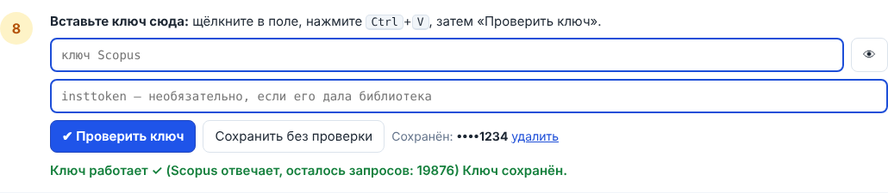

# Как получить ключи API для Scopus и Web of Science

Пошаговая инструкция для тех, кто делает это впервые. Ключ нужен один раз: вставили в
программу — и забыли.

> **Что такое ключ API.** Это длинный «пароль» из букв и цифр. По нему Scopus и Web of
> Science узнают, что поиск делает именно ваша программа. **Никому его не показывайте**
> и не публикуйте, в том числе на снимках экрана (замажьте его).

> **Без ключей тоже можно.** В окне «Получить список DOI» есть режим «Через браузер»: вы
> сами нажимаете «Экспорт» на сайте Scopus или WoS, а программа забирает файл. Ключи
> просто избавляют от этих нажатий.

**Оглавление** (нажмите, чтобы перейти):
- [Шаг 0. Спросите библиотеку](#шаг-0-спросите-библиотеку-5-минут-сэкономит-часы)
- [Часть 1. Ключ Scopus](#часть-1-ключ-scopus-elsevier)
- [Часть 2. Ключ Web of Science](#часть-2-ключ-web-of-science-clarivate)
- [Часть 3. OpenAlex — без ключа](#часть-3-openalex--без-ключа)
- [Как добавить снимки экрана](#как-добавить-снимки-экрана-в-эту-инструкцию)

Сайты Elsevier и Clarivate на английском. Ниже название каждой кнопки дано как на сайте
и в переводе. Если надпись чуть отличается, ищите похожую. 📷 отмечает место для снимка
экрана (как их добавить — в конце).

---

## Шаг 0. Спросите библиотеку (5 минут, сэкономит часы)

Напишите или позвоните в библиотеку университета:

> «Здравствуйте! Есть ли у университета доступ к **Scopus** и **Web of Science**? Я хочу
> искать литературу через их API (Scopus Search API, Web of Science Starter API). Нужен ли
> для этого institutional token (insttoken) от Elsevier и можете ли вы его запросить?»

- Если подписки на Scopus нет, ключ Scopus почти ничего не даст: ищите через Web of
  Science (у него есть бесплатный пробный план) или OpenAlex (без ключа).
- Если библиотека даст insttoken, сохраните его: он понадобится в шаге S8.

---

## Часть 1. Ключ Scopus (Elsevier)

Займёт 10–15 минут. Лучше делать на компьютере в сети университета.

**S1.** 👉 Нажмите ссылку: **[https://dev.elsevier.com](https://dev.elsevier.com/)**. Откроется сайт для
разработчиков Elsevier.

**S2.** Нажмите кнопку **«I want an API key»** («Мне нужен ключ API»).
📷 `scopus_01_glavnaya.png` — главная страница с этой кнопкой.

**S3.** Сайт попросит войти (**«Sign in»**).
- Если у вас есть вход в ScienceDirect, Scopus или Mendeley, это тот же аккаунт Elsevier:
  введите его почту и пароль.
- Если нет, нажмите **«Create account»** («Создать аккаунт») и введите университетскую
  почту, имя и пароль. Потом откройте почту, найдите письмо от Elsevier и нажмите в нём
  ссылку подтверждения.
- Иногда сайт предлагает войти через университет («Sign in via your organization»).
  Тогда выберите свой университет и войдите, как в личный кабинет.

📷 `scopus_02_vhod.png` — страница входа.

**S4.** Откроется страница **«My API Key»** («Мой ключ API»). Если она не открылась сама,
👉 нажмите ссылку: **[https://dev.elsevier.com/apikey/manage](https://dev.elsevier.com/apikey/manage)**.
Если по ней открылась ошибка, вернитесь к шагу S1. Нажмите **«Create API Key»**
(«Создать ключ API»).
📷 `scopus_03_create.png`

**S5.** Заполните форму:
- **Label** (название): латиницей **без пробелов**, например `ArticleDownloader`;
- **Website URL** (сайт): можно оставить пустым. Если не даёт — вставьте адрес сайта
  университета.

📷 `scopus_04_forma.png`

**S6.** Поставьте галочки согласия:
- с **API Service Agreement** (соглашение об использовании API);
- с условиями **Text and Data Mining** (если есть такая галочка).

Нажмите **«Submit»** («Отправить»). Бесплатный ключ даётся только для некоммерческого
использования, наука подходит.

**S7.** На странице **«My API Key»** появится ваш ключ: строка примерно из 32 латинских
букв и цифр, например `a1b2c3…`.
- Выделите её мышкой целиком (или нажмите значок копирования рядом, если он есть).
- Нажмите **Ctrl+C**.

📷 `scopus_05_kluch.png` — **ключ на снимке обязательно замажьте!**

**S8.** Вставьте ключ в программу:
1. Откройте программу (значок «Скачать статьи»).
2. Нажмите **«⚙ Настройки»**, затем **«🔑 Ключи API»**. Или в окне «Получить список DOI»
   нажмите **«Ввести ключи»**: откроется то же окно. В программе там эта же инструкция
   с кнопками, которые открывают нужные страницы.
3. Щёлкните в поле **«API-ключ Scopus»** и нажмите **Ctrl+V**.
4. Если библиотека дала insttoken, вставьте его в поле **«Insttoken Scopus»** так же.
5. Нажмите **«Проверить ключ»**.
6. Нажмите **«Сохранить»**.

**Что ответит «Проверить ключ»:**

| Ответ | Что делать |
|---|---|
| ✅ «Ключ работает» | Всё. |
| ❌ «Ключ неверный» | Скопируйте ключ ещё раз, целиком, без пробелов в начале и конце. |
| ⚠ «Нет доступа с этого компьютера» | Ключ верный, но Scopus не видит, что вы из университета. Подключитесь к сети или VPN университета либо попросите insttoken (письмо ниже). |
| ⚠ «Исчерпана квота» | Лимит запросов на неделю кончился, подождите. |

**Письмо для insttoken.** Отправьте его в библиотеку; если она не может помочь — в
поддержку Elsevier (👉 **[https://dev.elsevier.com](https://dev.elsevier.com/)** → раздел поддержки,
**«Support»**):

> Здравствуйте! Я [ФИО, должность], [университет]. Для поиска литературы через Scopus
> Search API прошу выдать institutional token (insttoken) для моего ключа API.
> Ключ: [вставьте ключ — только в этом письме]. Работаю из дома, поэтому нужен доступ
> вне сети университета. Спасибо!

---

## Часть 2. Ключ Web of Science (Clarivate)

Займёт 10–20 минут, но **одобрение может занять от нескольких дней до нескольких
недель**. Начните заранее.

**W1.** 👉 Нажмите ссылку: **[https://developer.clarivate.com](https://developer.clarivate.com/)**. Откроется сайт для
разработчиков Clarivate.

**W2.** Нажмите **«Sign in»** («Войти»).
- Аккаунт общий с другими сервисами Clarivate (Web of Science, EndNote). Если у вас есть
  личный вход в Web of Science, попробуйте его.
- Если нет, нажмите **«Register»** («Зарегистрироваться»), введите почту и пароль, затем
  подтвердите письмо в почте.

📷 `wos_01_vhod.png`

**W3.** Создайте «приложение» (так сайт называет вашу программу):
1. В верхнем меню нажмите **«Applications»** («Приложения»).
2. Нажмите **«Register new application»** («Зарегистрировать новое приложение»).
3. **Name** (название): `ArticleDownloader`.
4. **Description** (описание), если просят: `Personal literature search for research`.
5. Нажмите **«Submit»** / **«Register»**.

📷 `wos_02_applications.png`, `wos_03_new_app.png`

**W4.** Подпишите приложение на API:
1. 👉 Нажмите ссылку: **[https://developer.clarivate.com/apis/wos-starter](https://developer.clarivate.com/apis/wos-starter)**.
   Если она не открылась, в верхнем меню сайта нажмите **«APIs»** и найдите
   **«Web of Science Starter API»**.
2. Откроется страница **Web of Science Starter API**.
3. Выберите план:
   - **Free Trial** (бесплатный): подходит всем; ограничение — **до 50 запросов в день**
     (это до 2500 статей в день, для поиска литературы хватает);
   - **институциональный план**: если университет подписан на Web of Science. Лимиты
     больше, но нужно одобрение.
4. Нажмите **«Subscribe»** («Подписаться») и выберите своё приложение `ArticleDownloader`.

📷 `wos_04_starter_api.png`, `wos_05_subscribe.png`

**W5.** Найдите ключ:
1. Снова **«Applications»**, затем ваше приложение `ArticleDownloader`.
2. Там будет **API Key** (часто скрыт — нажмите **«Show»**, «Показать»).
3. Выделите и нажмите **Ctrl+C**.
4. Если написано, что подписка ждёт одобрения (pending), дождитесь письма от Clarivate.

📷 `wos_06_kluch.png` — **ключ замажьте!**

**W6.** Вставьте ключ в программу так же, как в шаге S8, только в поле **«API-ключ Web of
Science»**. Затем **«Проверить ключ»** → **«Сохранить»**.

---

## Часть 3. OpenAlex — без ключа

OpenAlex (👉 **[https://openalex.org](https://openalex.org/)**) — бесплатная база научных статей, ключ не нужен. В окне «Получить список DOI»
просто поставьте галочку **OpenAlex**. Для частого поиска можно взять бесплатный ключ на
[openalex.org](https://openalex.org/) и вставить его в окне ключей (необязательно).

---

## Как добавить снимки экрана в эту инструкцию

Снимки делаются один раз, когда вы сами проходите регистрацию.

1. На нужном шаге нажмите **Win + Shift + S** и выделите мышкой часть экрана: снимок
   окажется в буфере обмена.
2. Вставьте его в чат Claude Code (**Ctrl+V**) и напишите: «это снимок
   `scopus_02_vhod.png`» (имя из значка 📷 у шага).
3. Claude сохранит снимок в `portable/scripts/ui/img/keys/` и вставит его в эту инструкцию
   и во встроенное руководство программы.

**Перед отправкой замажьте на снимках ключи, пароли и почту.**
